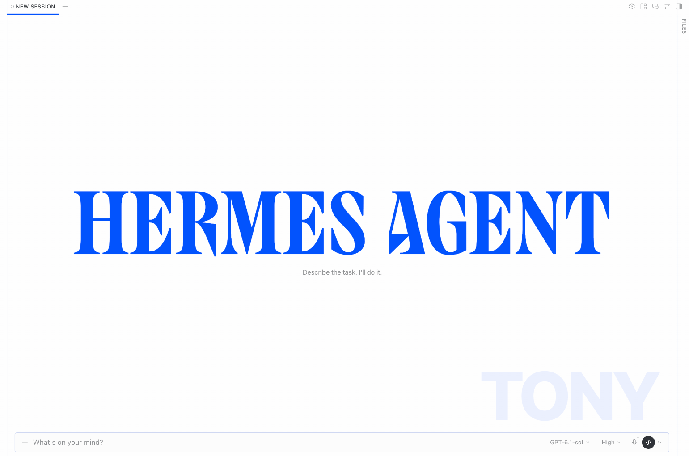

# Hermes Profile Watermark

A sleek desktop UI plugin for [Hermes Desktop](https://hermes-agent.nousresearch.com/docs/developer-guide/desktop-plugin-sdk) that displays a bold, subtle watermark of the active bot or profile in the chat background.

Never accidentally mix up which bot or profile you are chatting with.



## Highlights

- **Glanceable Identity**: Renders a large, modern typographic watermark (e.g. `HERMES`, `RESEARCH`, `CODER`, `ASSISTANT`, etc.) anchored at the bottom-right corner of the active chat.
- **Dynamic Profile Colors**: Automatically inherits custom colors configured via the Hermes profile rail picker (`localStorage`), falling back to Hermes's deterministic hue algorithm or active theme accent.
- **Smart Dock Clearance**: Dynamically observes `--composer-measured-height` so the watermark never gets covered by expanding multi-line composer inputs.
- **Non-Intrusive**: Styled with low opacity (`0.09`), `pointer-events: none`, and `user-select: none`. It never interferes with message reading, clicking, or text selection.
- **Zero Build / Hot Reload**: Plain ESM module. Drop it in and Hermes Desktop loads it instantly without any compilation or bundling.

## Installation

1. Create a directory named `profile-watermark` inside your Hermes Desktop plugins folder:

```bash
mkdir -p ~/.hermes/desktop-plugins/profile-watermark
```

2. Download `plugin.js` into that directory:

```bash
curl -fsSL https://raw.githubusercontent.com/ronnhd/hermes-profile-watermark/main/plugin.js \
  -o ~/.hermes/desktop-plugins/profile-watermark/plugin.js
```

3. In Hermes Desktop, press **⌘K** and select **Reload desktop plugins** (or restart the app).

## Configuration

- **Profile Colors**: Long-press or right-click any profile square on the sidebar profile rail to select a custom color swatch. The watermark will update immediately.
- **Default Profile Name**: The root (`default`) profile displays as `HERMES` by default. To customize what the default profile displays (e.g. your personal bot's name), run this in the DevTools console (`⌘⌥I`):

```js
localStorage.setItem('hermes.profileWatermark.defaultName', 'MY-BOT')
```

## License

MIT © [Ron Ng](https://github.com/ronnhd)
